<p align="center">
  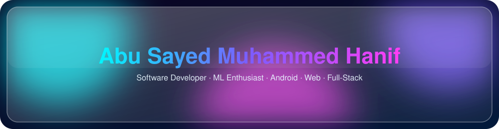
</p>

<p align="center">
  
</p>

<p align="center">
  <a href="https://github.com/asm-hanif"></a>
  <a href="https://github.com/asm-hanif?tab=repositories"></a>
  
</p>

<p align="center">
  <strong>💻 Software Developer &nbsp;•&nbsp; 📱 Android Developer &nbsp;•&nbsp; 🌐 Full-Stack Developer</strong><br>
  <em>Building useful technology that solves real-world problems.</em>
</p>

---


<table>
<tr>
<td width="55%" valign="top">

### 👋 Hey, I'm Hanif

I'm an undergraduate **Computer Science & Engineering** student passionate about turning ideas into practical software.

I enjoy working across the whole stack — designing interfaces, building Android apps, developing scalable backends and experimenting with Machine Learning.

#### 🎯 Currently Focused On
* 🤖 Machine Learning & AI
* ☁️ AWS AI/ML & Cloud Architecture
* 📱 Modern Android Development
* 🌐 Full-Stack Web Development
* 🔌 IoT & Smart Systems
* 🧩 Scalable Backend Architecture

</td>
<td width="45%" valign="top">

### ⚡ Quick Profile

```text
🎓 Education
CSE @ Premier University
Graduating: 2027

💻 Development   Full-Stack + Android
🧠 Interests     AI • ML • IoT • Cloud
⚙️ Backend       ASP.NET Core • Node.js
📱 Mobile        Kotlin • Jetpack Compose
🗄️ Database      MS SQL • PostgreSQL • Firebase
🌱 Learning      AWS AI/ML • Cloud-Native
```

</td>
</tr>
</table>

---


<p align="center">

**💻 Languages**<br>
<br><br>
**🌐 Web & Backend**<br>
<br><br>
**📱 Mobile & Cloud**<br>
<br><br>
**🗄️ Database & Tools**<br>


</p>

---


> **FlatMate** is a Bangladesh-wide property marketplace that connects owners with people who want to rent or buy — with **Mira**, a built-in AI assistant that suggests fair prices for owners and finds matching flats for seekers.

<table>
<tr>
<td width="50%" valign="top">

### ✨ Key Features

* 🏠 Listings for **Rent, Sale, or Rent & Sale**
* 🔍 Search with filters, sorting and pagination
* 🛋️ Detailed property summary + amenities (lift, parking, etc.)
* 🖼️ Multi-image & video upload and management
* 👤 Role-based accounts: **Owner · User (seeker) · Both**
* 📩 Rent / Buy / Inquiry **request workflow** (approve / reject)
* 🔔 In-app **notifications** for owners
* 💬 Owner ↔ seeker **chat**
* ❤️ Favorites / saved properties
* 🚩 **Report a listing** with email alert
* 🔐 Gmail-only sign-up, strong-password policy, bcrypt hashing
* 🔑 Password reset with a **one-time code** (10-min expiry, 5-attempt limit)
* 📊 Owner & seeker dashboards · 📱 responsive UI

</td>
<td width="50%" valign="top">

### 🤖 Mira — AI Property Assistant

**For owners**
* 💵 Price estimate from size, type, city & area (BDT)
* 📈 Low / fair / high price range
* 📍 Location-rate matching: exact area → city → national default

**For seekers**
* 🔎 Flat-finder from budget, purpose, type & size
* 🎯 Ranks active listings against preferences
* 🏡 Returns the best matches with cover photos

### ⚙️ Tech Stack

```text
Frontend  HTML5 · CSS3 · JavaScript
Backend   Node.js · Express.js
Database  PostgreSQL (sessions via connect-pg-simple)
Auth      express-session · bcrypt · RBAC
Uploads   Multer      Email  Nodemailer
AI        Price model + recommendation engine
```

</td>
</tr>
</table>

### 🧪 Quality & Testing


FlatMate ships with a full test suite built on Node's built-in test runner and Selenium WebDriver:

| Technique | Coverage |
|---|---|
| **Boundary Value Analysis** | 30 cases across validators, field parsing & column mapping |
| **Equivalence Class Testing** | 30 partition cases |
| **Decision Table Testing** | 29 rule tests — requests, registration, login |
| **Basis Path Testing** | 15 functions, 134 independent-path tests |
| **Unit Tests** | 45 consolidated cases |
| **API Integration** | 45+ live end-to-end API checks |
| **Selenium Automation** | 45 website + 90 end-to-end browser journeys |

### 📸 Screenshots


<p align="center">
  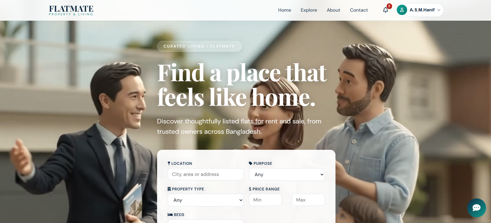
  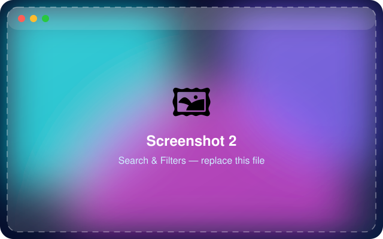
  
  <br>
  
  
  
</p>

<!-- TO ADD YOUR SCREENSHOTS: save them as media/flatmate-1.png ... flatmate-6.png,
     then change each "flatmate-placeholder-N.svg" above to "flatmate-N.png". -->

---

### 🏥 EasySheba — Healthcare Management Platform

> Connects patients with doctors, hospitals, diagnostic services, appointments and medical resources.

<table><tr>
<td>

* 🩺 Doctor appointment booking
* 🧪 Medical test scheduling
* 🛏️ Bed reservation
* 👨‍⚕️ Doctor & 🏥 hospital management
* 🔐 Role-based authentication
* 📊 Admin dashboards · 📍 Google Maps

</td>
<td>

```text
ASP.NET Core MVC · C#
Entity Framework
Microsoft SQL Server
Bootstrap · jQuery
Google Maps API · ASP.NET Identity
```

</td></tr></table>

<p align="center">
  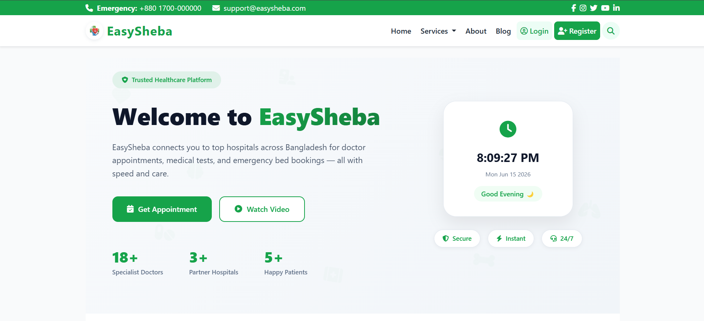 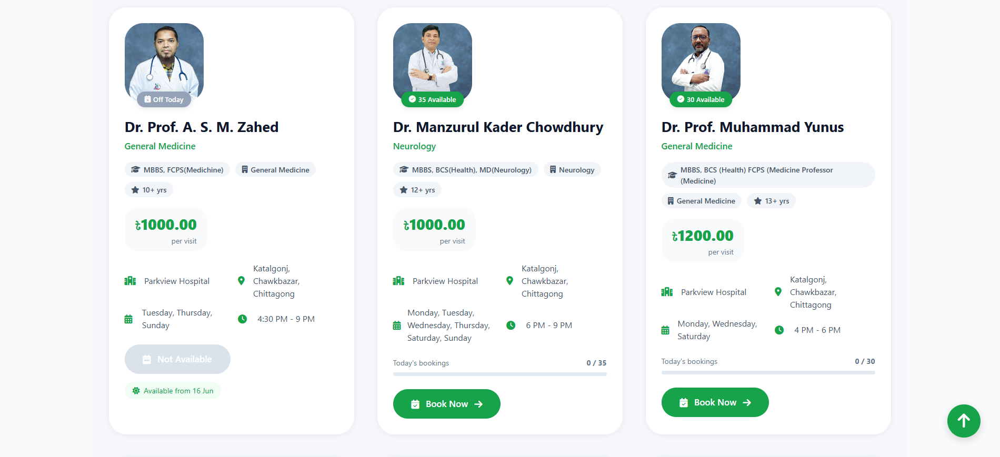<br><br>
  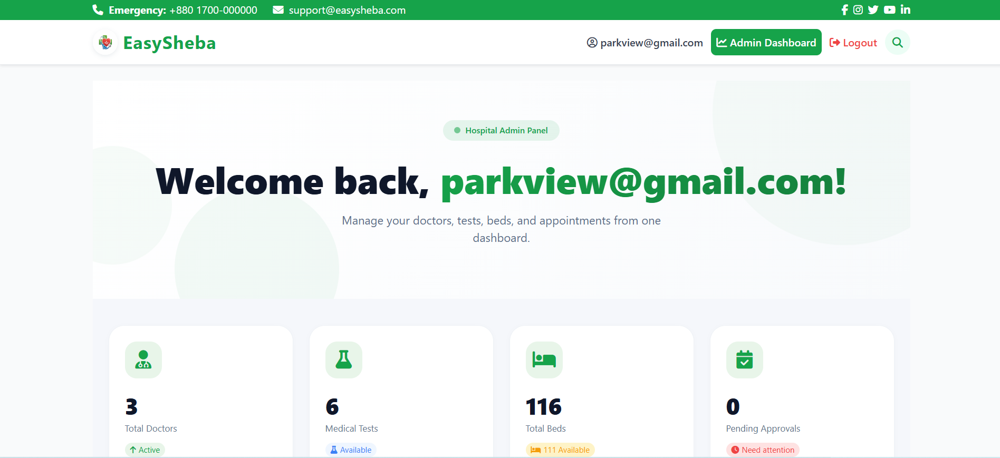 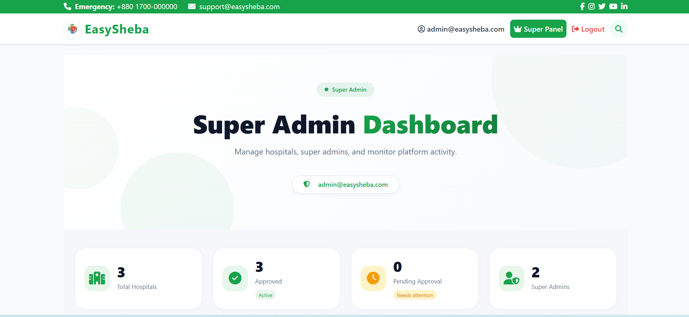
</p>

---

### 🛠️ KajLagbe — Local Service Marketplace

> A mobile marketplace connecting people who need services with local providers.

<table><tr>
<td width="50%">

* 🔐 Firebase Authentication
* 💬 Real-time messaging
* ⭐ Ratings & reviews
* 👤 Provider profiles · 📍 Local discovery

</td>
<td width="50%">

```text
Kotlin · Jetpack Compose
Firebase Auth · Cloud Firestore
Firebase Storage
```

</td></tr></table>

<p align="center">
  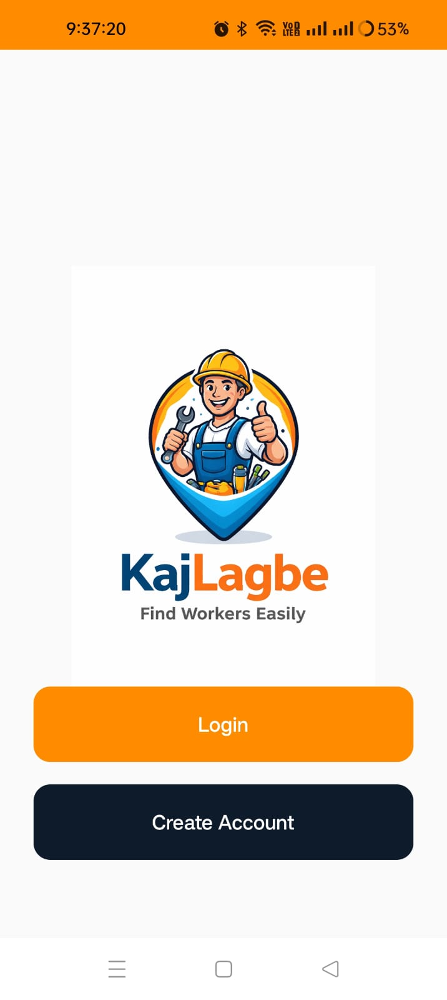 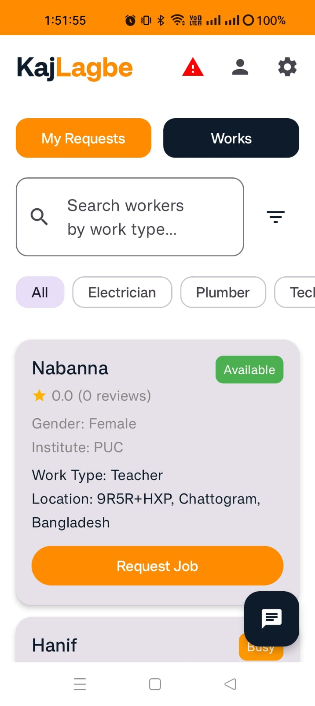
</p>

---

### 🌐 Campus Network System — University Network Simulation

> A simulated university network demonstrating enterprise routing, switching and security.

VLANs · ACLs · Routing · Access/Core switching · Serial links · Email server · IoT · Cloud connectivity — built in **Cisco Packet Tracer**.

<p align="center">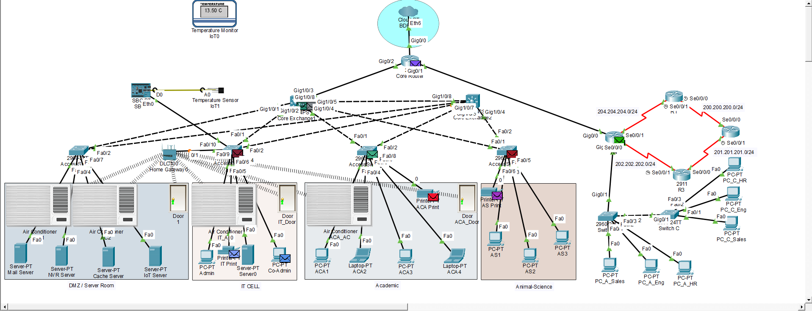</p>

---

### 🏙️ NagarFix — Smart City Service Platform

> Citizens report urban problems and track their resolution.

`Citizen → Report issue → Location tag → City Corporation → Processing → Status updates → Tracking`

**Kotlin • Firebase • Android**

<p align="center">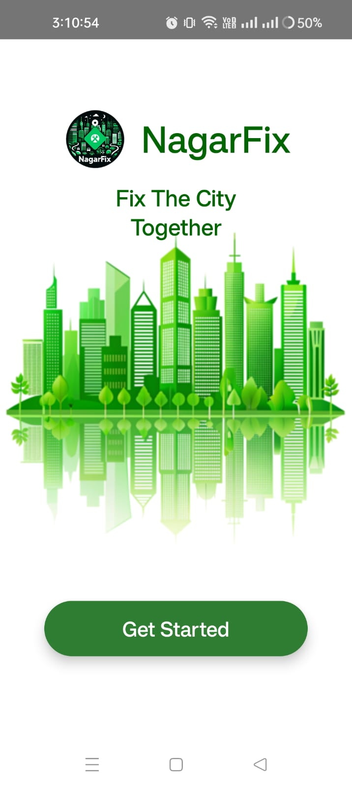 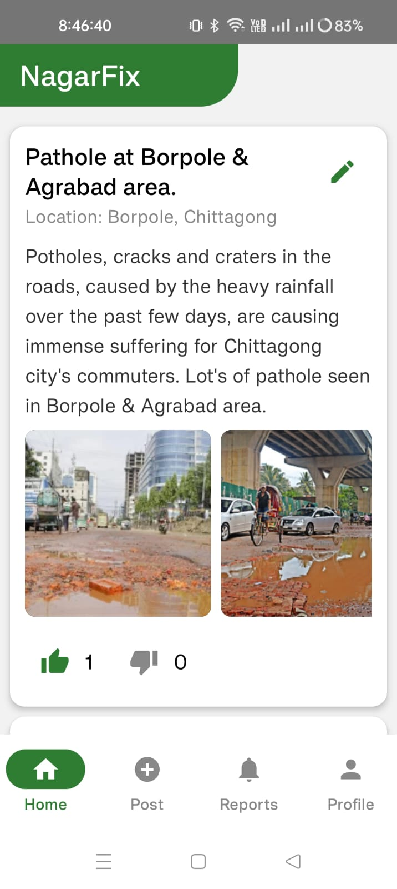</p>

---

### 🏠 Smart Home System — ESP32 IoT Automation

> Affordable, scalable IoT system to control household appliances remotely.

**Hardware:** ESP32 · IR sensors · Servo motors · Rain sensor · Wi-Fi  
**Capabilities:** remote control · real-time status · automated actions · smart monitoring

<p align="center">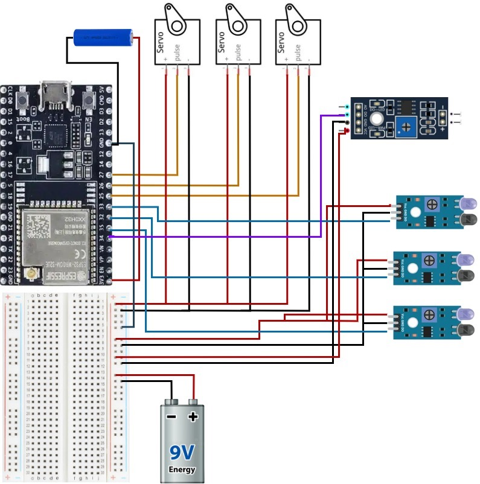 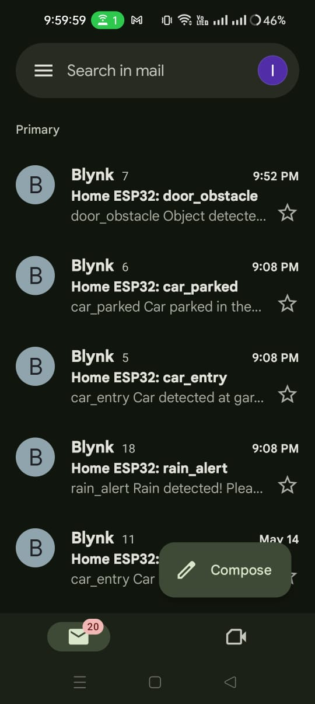</p>

---


<p align="center">
  
</p>

---


<p align="center">
<a href="https://linkedin.com/in/abu-sayed-muhammed-hanif-15b689374/"></a>
<a href="mailto:abusayed1952hanif@gmail.com"></a>
<a href="https://github.com/asm-hanif"></a>
</p>

---


<p align="center">
  <a href="https://asm-hanif.github.io/asm-hanif/dino.html">
    
  </a>
  <br><strong>👆 Click the game to play it for real</strong>
</p>

---


<p align="center">
  <a href="https://www.google.com/maps/search/?api=1&query=Chawkbazar%2C+Chattogram%2C+Bangladesh">
    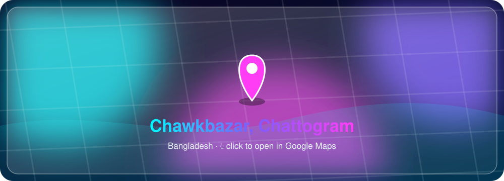
  </a>
</p>

<p align="center"><sub>💙 Thanks for visiting! If something caught your eye, consider ⭐ starring a repo.</sub></p>
