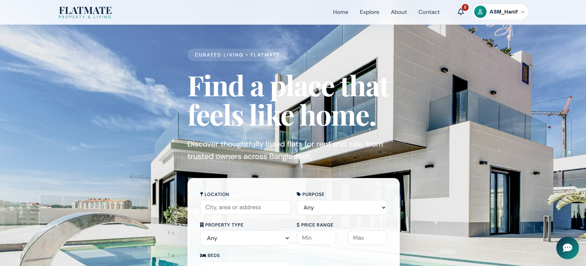
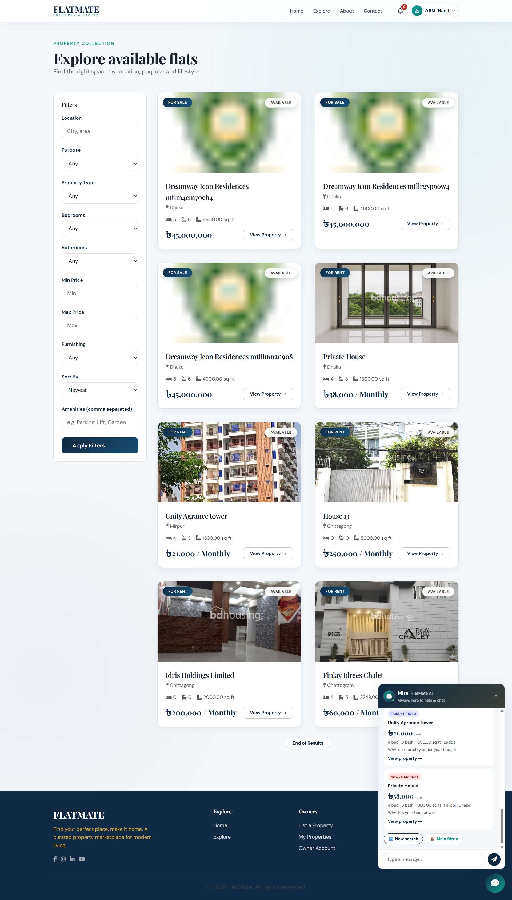
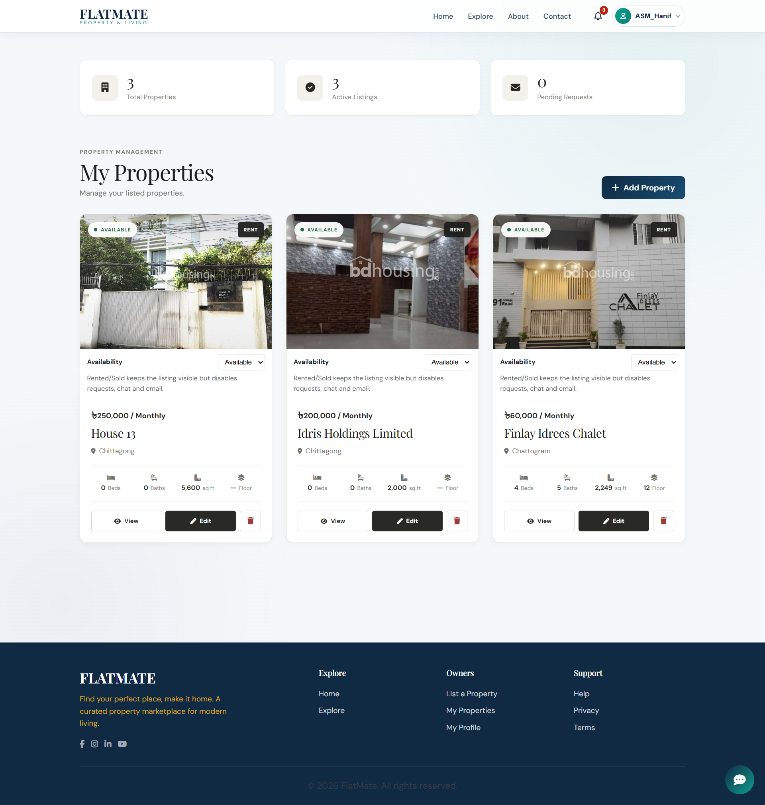
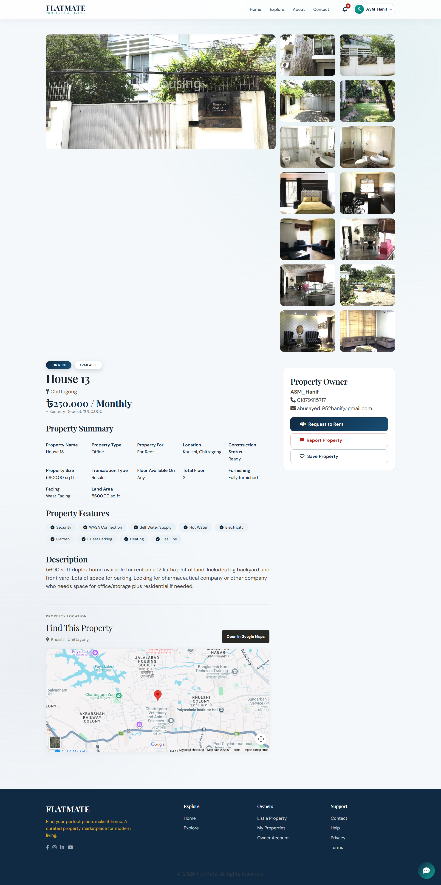

 

  

<a href="https://github.com/asm-hanif?tab=repositories">
  <!-- Replace the link above with your FlatMate repository or live site URL -->
  
</a>

  

  

 

  

  

 

  

 

  

 

  

 

  

  

  

  

