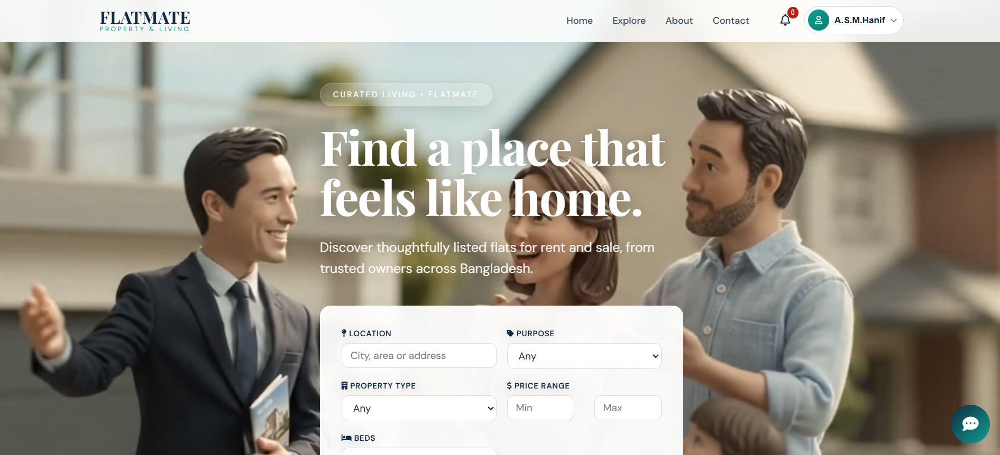
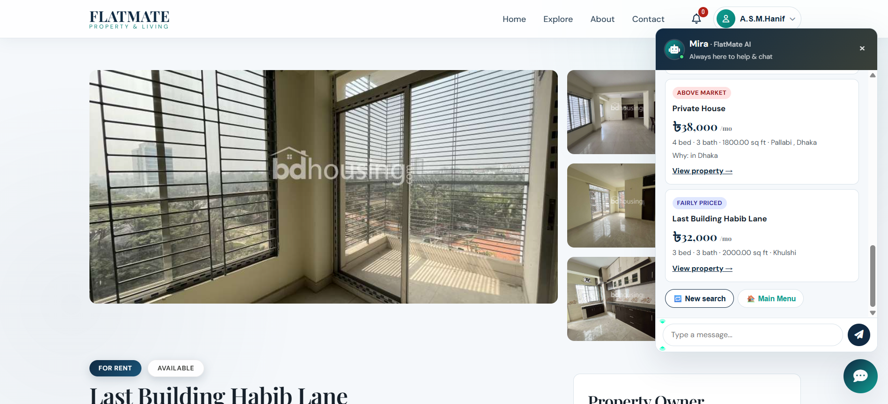
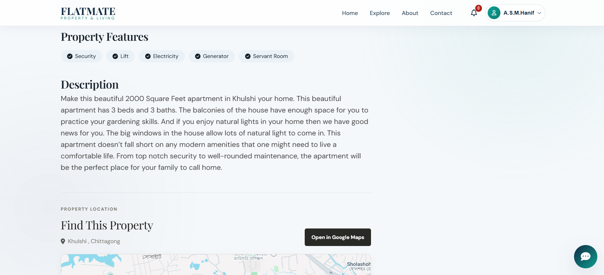
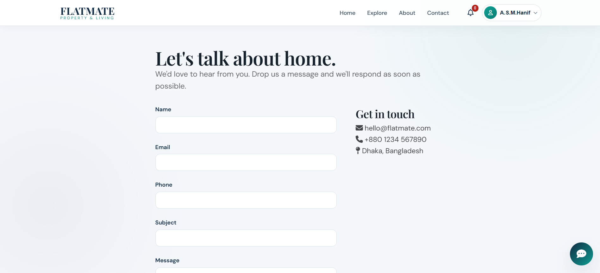
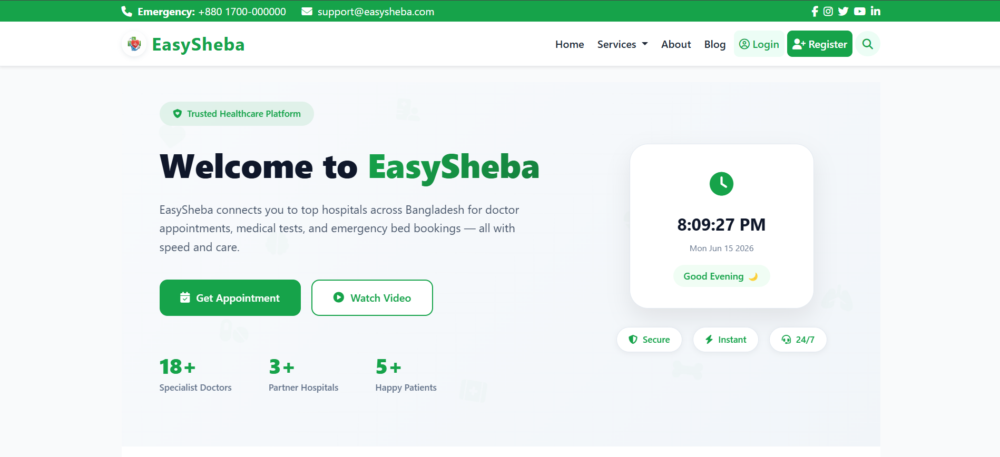
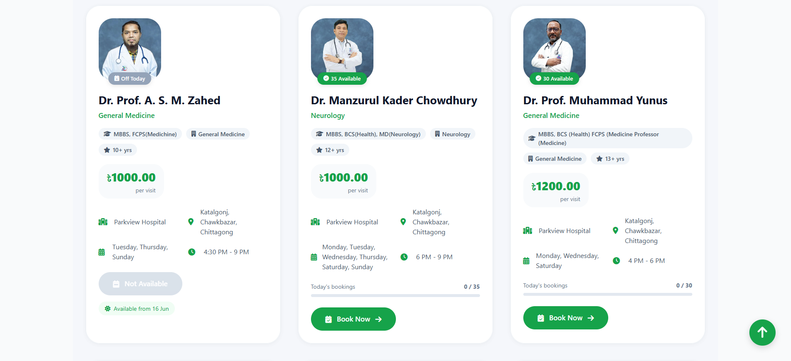
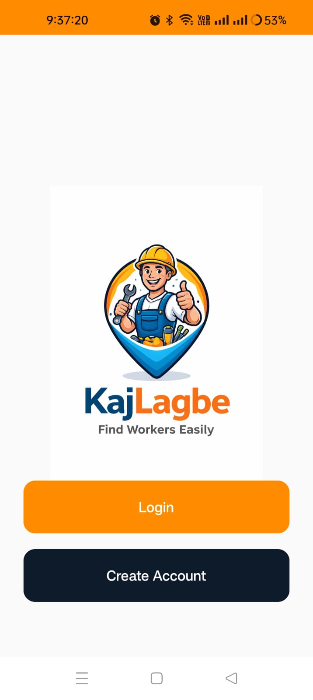
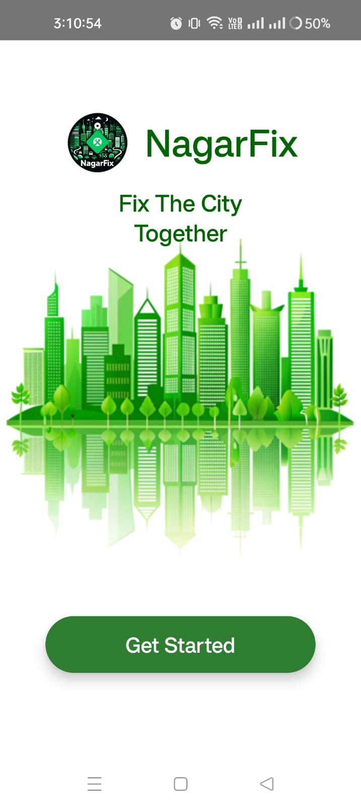
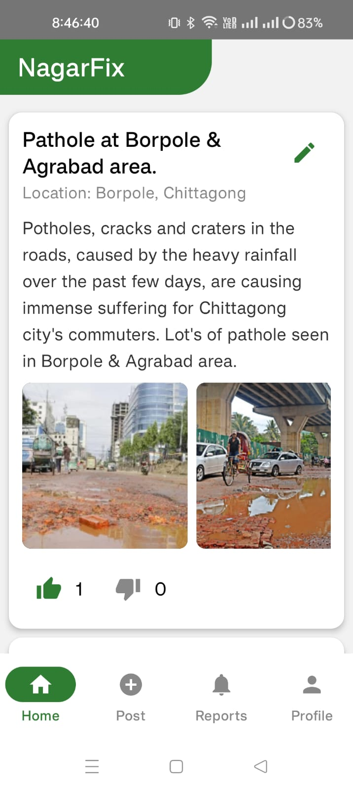

<!-- ═════════════════════════ HERO ═════════════════════════ -->
<p align="center">
  
</p>

<p align="center">
  
</p>

<p align="center">
  
</p>

<p align="center">
  <a href="https://github.com/asm-hanif">
    
  </a>
  <a href="https://github.com/asm-hanif?tab=repositories">
    
  </a>
  
</p>

<p align="center">
  <strong>◆ Software Developer &nbsp;·&nbsp; ◆ Android Developer &nbsp;·&nbsp; ◆ Full-Stack Developer</strong><br>
  <em>“Building useful technology that solves real-world problems.”</em>
</p>

<p align="center">
  
</p>

<!-- ═════════════════════════ I · ABOUT ═════════════════════════ -->
<p align="center">
  
</p>

<table>
<tr>
<td width="33%" align="center" valign="top">


Abu Sayed Muhammed Hanif

CSE @ Premier University
Graduating 2027

</td>
<td width="33%" align="center" valign="top">


Full-Stack + Android

ASP.NET Core • Node.js
Kotlin • Jetpack Compose

</td>
<td width="33%" align="center" valign="top">


AI • ML • IoT • Cloud

Learning AWS AI/ML
& Cloud-Native Architecture

</td>
</tr>
</table>

> 👋 Hey, I'm Hanif.
> I'm an undergraduate **Computer Science & Engineering** student passionate about transforming ideas into practical software.
> I enjoy working across the entire development stack — from designing interfaces and building Android applications to developing scalable backend systems and experimenting with Machine Learning.

<p align="center">
  <sub><b>CURRENTLY FOCUSED ON</b></sub><br><br>
  
  
  
  <br>
  
  
  
</p>

```text
╔══════════════════════════════════════════════════════════╗
║  H A N I F . S Y S                              ● ONLINE ║
╠══════════════════════════════════════════════════════════╣
║  EDUCATION    CSE @ Premier University · Class of 2027   ║
║  DEVELOPMENT  Full-Stack + Android                       ║
║  INTERESTS    AI · ML · IoT · Cloud                      ║
║  BACKEND      ASP.NET Core · Node.js                     ║
║  MOBILE       Kotlin · Jetpack Compose                   ║
║  DATABASE     MS SQL · PostgreSQL · Firebase             ║
║  LEARNING     AWS AI/ML · Cloud-Native Architecture      ║
╚══════════════════════════════════════════════════════════╝
```

<p align="center">
  
</p>

<!-- ═════════════════════════ II · TECH ═════════════════════════ -->
<p align="center">
  
</p>

<table>
<tr>
<th width="22%" align="left">LAYER</th>
<th align="left">INSTRUMENTS</th>
</tr>

<tr>
<td valign="middle">

01 · LANGUAGES
<sub>the alphabet</sub>

</td>
<td>


</td>
</tr>

<tr>
<td valign="middle">

02 · WEB & BACKEND
<sub>the engine room</sub>

</td>
<td>


</td>
</tr>

<tr>
<td valign="middle">

03 · MOBILE & CLOUD
<sub>in every pocket</sub>

</td>
<td>


</td>
</tr>

<tr>
<td valign="middle">

04 · DATA
<sub>the vault</sub>

</td>
<td>


</td>
</tr>

<tr>
<td valign="middle">

05 · TOOLS
<sub>the workshop</sub>

</td>
<td>


</td>
</tr>
</table>

<p align="center">
  
</p>

<!-- ═════════════════════════ III · PROJECTS ═════════════════════════ -->
<p align="center">
  
</p>

<table>
<tr>
<td align="center" width="33%">

01 · FlatMate
<sub>AI property marketplace</sub>

</td>
<td align="center" width="33%">

02 · EasySheba
<sub>healthcare platform</sub>

</td>
<td align="center" width="33%">

03 · KajLagbe
<sub>local service marketplace</sub>

</td>
</tr>
<tr>
<td align="center">

04 · Campus Network
<sub>university network simulation</sub>

</td>
<td align="center">

05 · NagarFix
<sub>smart city platform</sub>

</td>
<td align="center">

06 · Smart Home
<sub>ESP32 IoT automation</sub>

</td>
</tr>
</table>

<br>

<!-- ───────────── 01 · FLATMATE ───────────── -->
<p align="center">
  
</p>

<p align="center">
  
  
  
  
  
  
</p>

> A Bangladesh-wide property marketplace that connects property owners with people looking to buy or rent properties, enhanced with an AI assistant named Mira that helps owners estimate suitable property prices and helps seekers discover properties based on their requirements.

<table>
<tr>
<td width="50%" valign="top">

◆ Key Features

 🏠 Property listing for sale, rent, or both
 🔍 Advanced property search & filtering
 📍 Property discovery across Bangladesh
 💰 Buy & rental property marketplace
 👤 Role-based **Owner & Seeker** accounts
 📝 Owners can create & manage listings
 ❤️ Save / favorite properties
 📩 Property request & inquiry system
 🖼️ Property image & media management
 📊 Role-based dashboards
 🔐 Secure authentication & authorization
 📱 Responsive web interface

</td>

<td width="50%" valign="top">

◆ Mira — AI Property Assistant

Mira is the intelligent assistant built into FlatMate to make property decisions easier.

For Owners

 💵 Estimates suitable property pricing
 🏠 Analyzes property specifications
 📊 Helps determine a competitive price
 🎯 Supports better listing decisions

For Property Seekers

 🔎 Understands their requirements
 🏡 Finds suitable properties
 🎯 Matches preferences with available listings
 💡 Helps narrow down property choices

</td>
</tr>
</table>

<table>
<tr>
<td width="50%" valign="top">

◆ How Mira Works

```text
                    ┌───────────────────┐
                    │       MIRA        │
                    │  AI Property      │
                    │     Assistant     │
                    └─────────┬─────────┘
                              │
               ┌──────────────┴──────────────┐
               │                             │
               ▼                             ▼
        🏠 PROPERTY OWNER             🔍 PROPERTY SEEKER
               │                             │
      Property Specifications          Requirements
               │                             │
               ▼                             ▼
        Price Estimation              Property Matching
               │                             │
               └──────────────┬──────────────┘
                              ▼
                    Better Property
                       Decisions
```

</td>
<td width="50%" valign="top">

 ◆ Technology

```text
HTML5
CSS3
JavaScript
Node.js
Express.js
PostgreSQL
REST APIs
Role-Based Access Control
Session Authentication
AI-Assisted Property Analysis
AI Property Recommendation
```

</td>
</tr>
</table>

<!-- Add your FlatMate screenshots here -->
<table>
<tr>
<td width="50%" align="center"><br><sub>◆ INTERFACE 01</sub></td>
<td width="50%" align="center"><br><sub>◆ INTERFACE 02</sub></td>
</tr>
<tr>
<td width="50%" align="center"><br><sub>◆ INTERFACE 03</sub></td>
<td width="50%" align="center"><br><sub>◆ INTERFACE 04</sub></td>
</tr>
<tr>
<td width="50%" align="center"><br><sub>◆ INTERFACE 05</sub></td>
<td width="50%" align="center"><br><sub>◆ INTERFACE 06</sub></td>
</tr>
</table>

<p align="center">
  
</p>

<!-- ───────────── 02 · EASYSHEBA ───────────── -->
<p align="center">
  
</p>

<p align="center">
  
  
  
  
  
  
</p>

> A comprehensive healthcare platform designed to connect patients with doctors, hospitals, diagnostic services, appointments and medical resources.

<table>
<tr>
<td width="50%" valign="top">

 ◆ Key Features

 🩺 Doctor appointment booking
 🧪 Medical test scheduling
 🛏️ Bed reservation
 👨‍⚕️ Doctor management
 🏥 Hospital management
 🔐 Role-based authentication
 📊 Administrative dashboards
 📍 Google Maps integration

</td>
<td width="50%" valign="top">

 ◆ Technology

```text
ASP.NET Core MVC
C#
Entity Framework
Microsoft SQL Server
Bootstrap
jQuery
Google Maps API
ASP.NET Identity
```

</td>
</tr>
</table>

<table>
<tr>
<td width="50%" align="center"><br><sub>◆ INTERFACE 01</sub></td>
<td width="50%" align="center"><br><sub>◆ INTERFACE 02</sub></td>
</tr>
<tr>
<td width="50%" align="center"><br><sub>◆ INTERFACE 03</sub></td>
<td width="50%" align="center"><br><sub>◆ INTERFACE 04</sub></td>
</tr>
</table>

<p align="center">
  
</p>

<!-- ───────────── 03 · KAJLAGBE ───────────── -->
<p align="center">
  
</p>

<p align="center">
  
  
  
  
  
</p>

> A mobile marketplace connecting people who need services with local service providers.

<table>
<tr>
<td width="50%" valign="top">

 ◆ Features

 🔐 Firebase Authentication
 💬 Real-time messaging
 ⭐ Rating & review system
 👤 Service provider profiles
 📍 Local service discovery
 ⚡ Real-time data synchronization

</td>

<td width="50%" valign="top">

 ◆ Built With


Architecture

```text
Kotlin
Jetpack Compose
Firebase Auth
Cloud Firestore
Firebase Storage
```

</td>
</tr>
</table>

<table>
<tr>
<td width="50%" align="center"><br><sub>◆ SCREEN 01</sub></td>
<td width="50%" align="center"><br><sub>◆ SCREEN 02</sub></td>
</tr>
</table>

<p align="center">
  
</p>

<!-- ───────────── 04 · CAMPUS NETWORK ───────────── -->
<p align="center">
  
</p>

<p align="center">
  
  
  
  
</p>

> A complete simulated university network designed to demonstrate enterprise networking, routing, switching and security concepts.

<table>
<tr>
<td width="50%" valign="top">

 ◆ Networking

 VLAN configuration
 ACL implementation
 Routing
 Access switching
 Serial connections
 Email server
 IoT integration
 Cloud connectivity

</td>

<td width="50%" valign="top">

◆ Tools

```text
Cisco Packet Tracer

Routers
Core Switches
Access Switches
VLANs
ACLs
IoT Devices
Servers
```

</td>
</tr>
</table>

<table>
<tr>
<td align="center"><br><sub>◆ TOPOLOGY</sub></td>
</tr>
</table>

<p align="center">
  
</p>

<!-- ───────────── 05 · NAGARFIX ───────────── -->
<p align="center">
  
</p>

<p align="center">
  
  
  
  
</p>

> A citizen-focused platform that allows people to report urban problems and track their resolution.

<table>
<tr>
<td width="50%" valign="top">

 ◆ Problem → Solution

```text
Citizen
   ↓
Report Urban Issue
   ↓
Location Tagging
   ↓
City Corporation
   ↓
Issue Processing
   ↓
Status Updates
   ↓
Citizen Tracking
```

</td>

<td width="50%" valign="top">

 ◆ Features

 📍 Location-based issue reporting
 📸 Issue documentation
 📊 Resolution tracking
 🔄 Real-time updates
 🏙️ Smart city management

Technology: Kotlin • Firebase • Android

</td>
</tr>
</table>

<table>
<tr>
<td width="50%" align="center"><br><sub>◆ SCREEN 01</sub></td>
<td width="50%" align="center"><br><sub>◆ SCREEN 02</sub></td>
</tr>
</table>

<p align="center">
  
</p>

<!-- ───────────── 06 · SMART HOME ───────────── -->
<p align="center">
  
</p>

<p align="center">
  
  
  
  
</p>

> An affordable and scalable IoT-based smart home system for remotely controlling household appliances.

<table>
<tr>
<td width="50%" valign="top">

 ◆ Hardware

 ESP32
 IR Sensors
 Servo Motors
 Rain Sensor
 Wi-Fi connectivity

</td>

<td width="50%" valign="top">

 ◆ Capabilities

 Remote appliance control
 Real-time device status
 Automated actions
 Wi-Fi communication
 Smart monitoring

</td>
</tr>
</table>

<table>
<tr>
<td width="60%" align="center"><br><sub>◆ PROTOTYPE 01</sub></td>
<td width="40%" align="center"><br><sub>◆ PROTOTYPE 02</sub></td>
</tr>
</table>

<p align="center">
  
</p>

<!-- ═════════════════════════ IV · ANALYTICS ═════════════════════════ -->
<p align="center">
  
</p>

<p align="center">
  
  
</p>

<p align="center">
  
</p>

<p align="center">
  <sub><b>CONTRIBUTION ACTIVITY</b></sub><br><br>
  
</p>

<p align="center">
  
</p>

<!-- ═════════════════════════ V · PHILOSOPHY ═════════════════════════ -->
<p align="center">
  
</p>

<table>
<tr>
<td align="center" width="25%">

 🎯

Solve Problems

Build technology that has a real purpose.

</td>

<td align="center" width="25%">

 ⚡

Keep Learning

Always explore new technologies and ideas.

</td>

<td align="center" width="25%">

 🧠

Think Scalable

Design systems with growth in mind.

</td>

<td align="center" width="25%">

🚀

Build & Ship

Turn concepts into working products.

</td>
</tr>
</table>

<p align="center">
  <sub><b>CURRENTLY EXPLORING</b></sub><br><br>
  
  
  
  <br>
  
  
  
</p>

<p align="center">
  
</p>

<!-- ═════════════════════════ VI · MAP ═════════════════════════ -->
<p align="center">
  
</p>

<p align="center">
  <a href="https://www.google.com/maps/search/?api=1&query=Chawkbazar+Chittagong+Bangladesh">
    
  </a>
</p>

<p align="center">
  <a href="https://www.google.com/maps/search/?api=1&query=Chawkbazar+Chittagong+Bangladesh">
    
  </a>
  <a href="https://www.openstreetmap.org/search?query=Chawkbazar%20Chittagong">
    
  </a>
</p>

<p align="center">
  
</p>

<!-- ═════════════════════════ VII · CONNECT ═════════════════════════ -->
<p align="center">
  
</p>

<p align="center">

<a href="https://linkedin.com/in/abu-sayed-muhammed-hanif-15b689374/">

</a>

<a href="mailto:abusayed1952hanif@gmail.com">

</a>

<a href="https://github.com/asm-hanif">

</a>

</p>

<p align="center">

<sub>✦ Thanks for visiting my profile ✦</sub><br>
<sub>If you find something interesting here, consider ⭐ starring the repository.</sub>

<br><br>


</p>

<p align="center">
  
</p>
