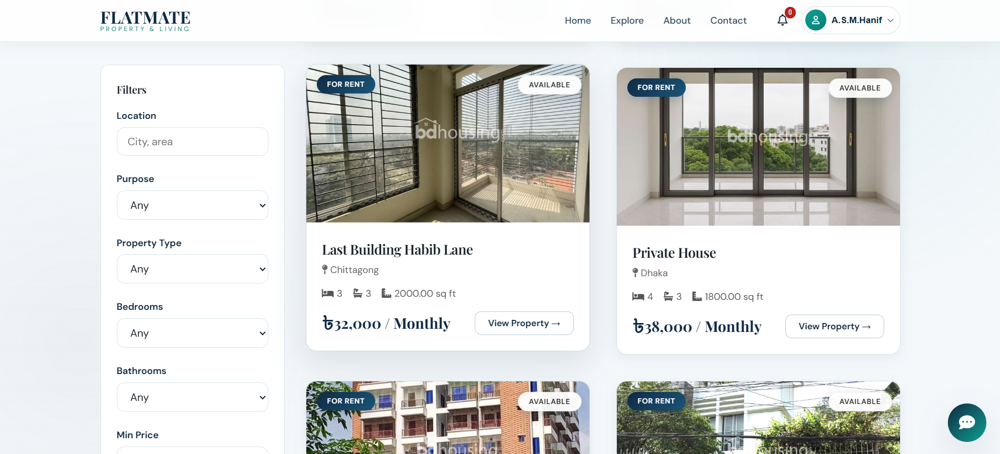
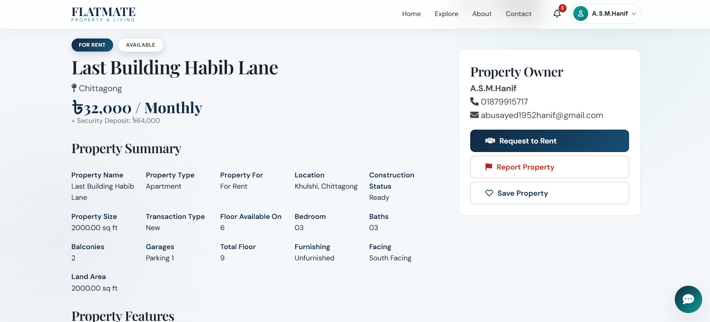
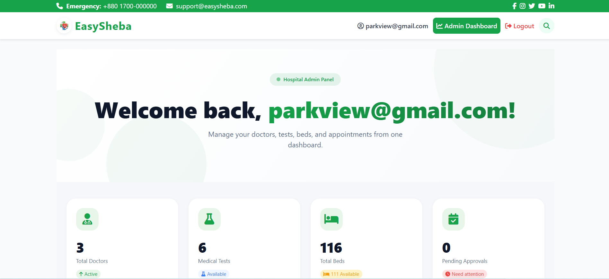
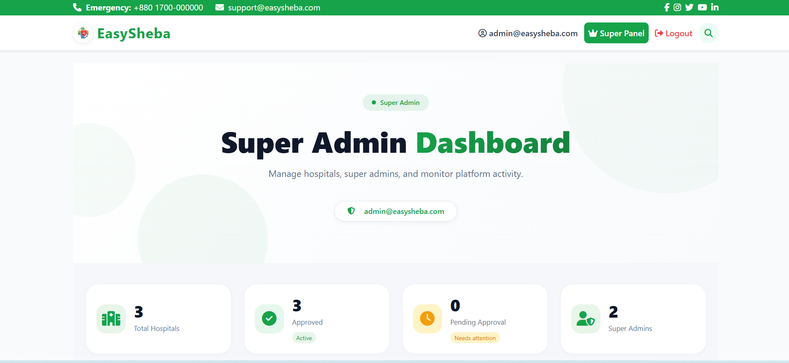
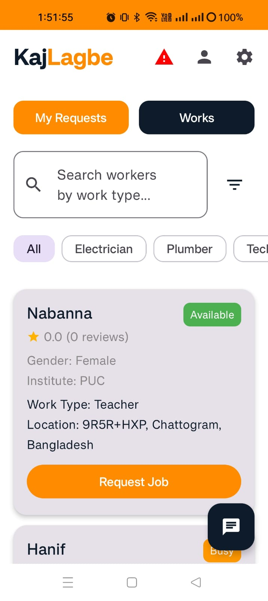
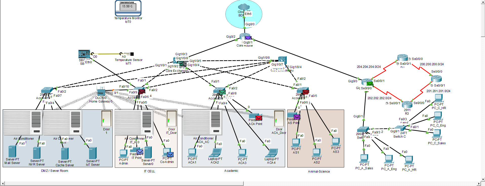
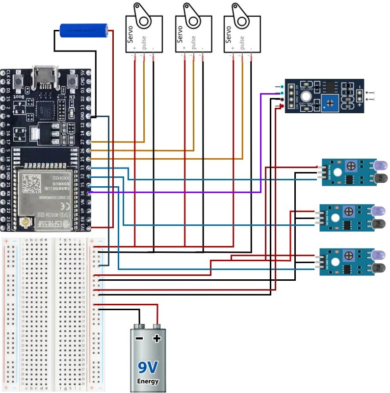
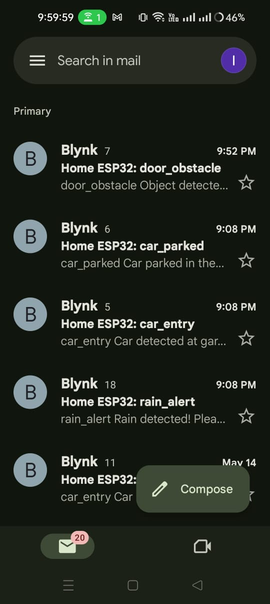

<!-- ═══════════════ HERO · THE FOURTH DIMENSION IS TIME (animated) ═══════════════ -->
<p align="center">
  
</p>

<p align="center">
  
</p>

<p align="center">
  
</p>

<p align="center">
  <a href="https://github.com/asm-hanif">
    
  </a>
  <a href="https://github.com/asm-hanif?tab=repositories">
    
  </a>
</p>

<br>

<p align="center">
  <strong>◆ Software Developer &nbsp;·&nbsp; ◆ Android Developer &nbsp;·&nbsp; ◆ Full-Stack Developer</strong>
</p>

<p align="center">
  <em>“Building useful technology that solves real-world problems.”</em>
</p>

<p align="center">
  
</p>

<!-- ═══════════════ ABOUT ═══════════════ -->
<p align="center">
  
</p>

<table>
<tr>
<td width="55%" valign="top">

👋 Hey, I'm Hanif

I'm an undergraduate Computer Science & Engineering student passionate about transforming ideas into practical software.

I enjoy working across the entire development stack — from designing interfaces and building Android applications to developing scalable backend systems and experimenting with Machine Learning.

🎯 Currently Focused On

* 🤖 Machine Learning & AI
* ☁️ AWS AI/ML & Cloud Architecture
* 📱 Modern Android Development
* 🌐 Full-Stack Web Development
* 🔌 IoT & Smart Systems
* 🧩 Scalable Backend Architecture

</td>

<td width="45%" valign="top">

### ⚡ Quick Profile

```text
◆ EDUCATION
  CSE @ Premier University
  Graduating: 2027

◆ DEVELOPMENT
  Full-Stack + Android

◆ INTERESTS
  AI • ML • IoT • Cloud

◆ BACKEND
  ASP.NET Core • Node.js

◆ MOBILE
  Kotlin • Jetpack Compose

◆ DATABASE
  MS SQL • PostgreSQL • Firebase

◆ LEARNING
  AWS AI/ML
  Cloud-Native Architecture
```

</td>
</tr>
</table>

<p align="center">
  
</p>

<!-- ═══════════════ TECH ═══════════════ -->
<p align="center">
  
</p>

<p align="center">

<sub><b>💻 LANGUAGES</b></sub><br>


<br><br>

<sub><b>🌐 WEB & BACKEND</b></sub><br>


<br><br>

<sub><b>📱 MOBILE & CLOUD</b></sub><br>


<br><br>

<sub><b>🗄️ DATABASE & TOOLS</b></sub><br>


</p>

<p align="center">
  
</p>

<!-- ═══════════════ PROJECTS ═══════════════ -->
<p align="center">
  
</p>

## 🏠 FlatMate

**AI-Powered Property Marketplace & Rental Platform**

> A Bangladesh-wide property marketplace that connects property owners with people looking to buy or rent properties, enhanced with an AI assistant named Mira that helps owners estimate suitable property prices and helps seekers discover properties based on their requirements.

<table>
<tr>
<td width="50%" valign="top">

### ✨ Key Features

* 🏠 Property listing for **sale, rent, or both**
* 🔍 Advanced property search & filtering
* 📍 Property discovery across Bangladesh
* 💰 Buy & rental property marketplace
* 👤 Role-based **Owner & Seeker** accounts
* 📝 Owners can create & manage listings
* ❤️ Save / favorite properties
* 📩 Property request & inquiry system
* 🖼️ Property image & media management
* 📊 Role-based dashboards
* 🔐 Secure authentication & authorization
* 📱 Responsive web interface

</td>

<td width="50%" valign="top">

### 🤖 Mira — AI Property Assistant

Mira is the intelligent assistant built into FlatMate to make property decisions easier.

**For Owners**

* 💵 Estimates suitable property pricing
* 🏠 Analyzes property specifications
* 📊 Helps determine a competitive price
* 🎯 Supports better listing decisions

**For Property Seekers**

* 🔎 Understands their requirements
* 🏡 Finds suitable properties
* 🎯 Matches preferences with available listings
* 💡 Helps narrow down property choices

</td>
</tr>
</table>

### 🧠 How Mira Works

```text
                    ┌───────────────────┐
                    │       MIRA        │
                    │  AI Property      │
                    │     Assistant     │
                    └─────────┬─────────┘
                              │
               ┌──────────────┴──────────────┐
               │                             │
               ▼                             ▼
        🏠 PROPERTY OWNER             🔍 PROPERTY SEEKER
               │                             │
      Property Specifications          Requirements
               │                             │
               ▼                             ▼
        Price Estimation              Property Matching
               │                             │
               └──────────────┬──────────────┘
                              ▼
                    Better Property
                       Decisions
```

### ⚙️ Technology

```text
HTML5
CSS3
JavaScript
Node.js
Express.js
PostgreSQL
REST APIs
Role-Based Access Control
Session Authentication
AI-Assisted Property Analysis
AI Property Recommendation
```

<p align="center">
  <!-- Add your FlatMate screenshots here -->
  
  
  <br><br>
  
  
  <br><br>
  
  
</p>

<p align="center">
  
</p>

## 🏥 EasySheba

**Healthcare Management & Medical Service Platform**

> A comprehensive healthcare platform designed to connect patients with doctors, hospitals, diagnostic services, appointments and medical resources.

<table>
<tr>
<td>

### ✨ Key Features

* 🩺 Doctor appointment booking
* 🧪 Medical test scheduling
* 🛏️ Bed reservation
* 👨‍⚕️ Doctor management
* 🏥 Hospital management
* 🔐 Role-based authentication
* 📊 Administrative dashboards
* 📍 Google Maps integration

</td>
<td>

### ⚙️ Technology

```text
ASP.NET Core MVC
C#
Entity Framework
Microsoft SQL Server
Bootstrap
jQuery
Google Maps API
ASP.NET Identity
```

</td>
</tr>
</table>

<p align="center">
  
  
  <br><br>
  
  
</p>

<p align="center">
  
</p>

## 🛠️ KajLagbe

**Local Service Marketplace**

> A mobile marketplace connecting people who need services with local service providers.

<table>
<tr>
<td width="50%">

### 🔥 Features

* 🔐 Firebase Authentication
* 💬 Real-time messaging
* ⭐ Rating & review system
* 👤 Service provider profiles
* 📍 Local service discovery
* ⚡ Real-time data synchronization

</td>

<td width="50%">

### 📱 Built With


<br><br>

**Architecture**

```text
Kotlin
Jetpack Compose
Firebase Auth
Cloud Firestore
Firebase Storage
```

</td>
</tr>
</table>

<p align="center">
  
  
</p>

<p align="center">
  
</p>

## 🌐 Campus Network System

**University Network Simulation**

> A complete simulated university network designed to demonstrate enterprise networking, routing, switching and security concepts.

<table>
<tr>
<td>

### 🔌 Networking

* VLAN configuration
* ACL implementation
* Routing
* Access switching
* Serial connections
* Email server
* IoT integration
* Cloud connectivity

</td>

<td>

### 🧰 Tools

```text
Cisco Packet Tracer

Routers
Core Switches
Access Switches
VLANs
ACLs
IoT Devices
Servers
```

</td>
</tr>
</table>

<p align="center">
  
</p>

<p align="center">
  
</p>

## 🏙️ NagarFix

**Smart City Service Platform**

> A citizen-focused platform that allows people to report urban problems and track their resolution.

### 🚧 Problem → Solution

```text
Citizen
   ↓
Report Urban Issue
   ↓
Location Tagging
   ↓
City Corporation
   ↓
Issue Processing
   ↓
Status Updates
   ↓
Citizen Tracking
```

### ✨ Features

* 📍 Location-based issue reporting
* 📸 Issue documentation
* 📊 Resolution tracking
* 🔄 Real-time updates
* 🏙️ Smart city management

**Technology:** Kotlin • Firebase • Android

<p align="center">
  
  
</p>

<p align="center">
  
</p>

## 🏠 Smart Home System

**ESP32 IoT Automation Project**

> An affordable and scalable IoT-based smart home system for remotely controlling household appliances.

<table>
<tr>
<td>

### 🔌 Hardware

* ESP32
* IR Sensors
* Servo Motors
* Rain Sensor
* Wi-Fi connectivity

</td>

<td>

### ⚡ Capabilities

* Remote appliance control
* Real-time device status
* Automated actions
* Wi-Fi communication
* Smart monitoring

</td>
</tr>
</table>

<p align="center">
  
  
</p>

<p align="center">
  
</p>

<!-- ═══════════════ ANALYTICS ═══════════════ -->
<p align="center">
  
</p>

<p align="center">
  
  
</p>

<p align="center">
  
</p>

<p align="center">
  
</p>

<p align="center">
  <sub><b>CONTRIBUTION ACTIVITY</b></sub><br><br>
  
</p>

<p align="center">
  
</p>

<!-- ═══════════════ PHILOSOPHY ═══════════════ -->
<p align="center">
  
</p>

<table>
<tr>
<td align="center" width="25%">

### 🎯

**Solve Problems**

Build technology that has a real purpose.

</td>

<td align="center" width="25%">

### ⚡

**Keep Learning**

Always explore new technologies and ideas.

</td>

<td align="center" width="25%">

### 🧠

**Think Scalable**

Design systems with growth in mind.

</td>

<td align="center" width="25%">

### 🚀

**Build & Ship**

Turn concepts into working products.

</td>
</tr>
</table>

<p align="center">
  
</p>

<!-- ═══════════════ EXPLORING ═══════════════ -->
<p align="center">
  
</p>

<p align="center">

`🤖 Machine Learning` &nbsp; `☁️ AWS` &nbsp; `🧠 AI Systems`

`🏗️ Cloud Architecture` &nbsp; `📱 Advanced Android` &nbsp; `🔌 IoT`

</p>

<p align="center">
  
</p>

<!-- ═══════════════ MAP ═══════════════ -->
<p align="center">
  
</p>

<p align="center">
  
</p>

<p align="center">
  <a href="https://www.google.com/maps/search/?api=1&query=Chawkbazar+Chittagong+Bangladesh">
    
  </a>
</p>

<p align="center">
  <a href="https://www.google.com/maps/search/?api=1&query=Chawkbazar+Chittagong+Bangladesh">
    
  </a>
  <a href="https://www.openstreetmap.org/search?query=Chawkbazar%20Chittagong">
    
  </a>
</p>

<p align="center">
  
</p>

<!-- ═══════════════ CONNECT ═══════════════ -->
<p align="center">
  
</p>

<p align="center">

<a href="https://linkedin.com/in/abu-sayed-muhammed-hanif-15b689374/">

</a>

<a href="mailto:abusayed1952hanif@gmail.com">

</a>

<a href="https://github.com/asm-hanif">

</a>

</p>

<br>

<p align="center">

<sub>✦ Thanks for visiting my profile ✦</sub>

<sub>If you find something interesting here, consider ⭐ starring the repository.</sub>

<br><br>


</p>

<p align="center">
  
</p>
